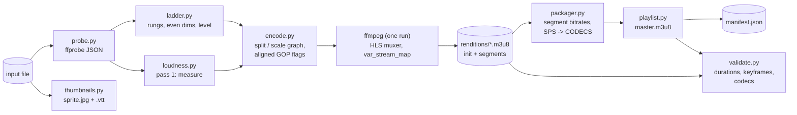

# abr-hls-packager

[](https://github.com/rahulkumar96t/abr-hls-packager/actions/workflows/ci.yml)

`abr-pack` turns a video file into an adaptive-bitrate HLS package with one FFmpeg run: it
probes the source, picks a rendition ladder that never upscales, encodes every rendition in a
single pass with time-aligned GOPs, writes fMP4/CMAF or MPEG-TS segments, a master playlist with
measured `BANDWIDTH` / `AVERAGE-BANDWIDTH`, `RESOLUTION`, `CODECS` and `FRAME-RATE`, optionally
normalises loudness to EBU R128, renders a thumbnail sprite with a WebVTT track, records a job
manifest, and can validate the result (segment durations, keyframe alignment, codec strings).
It is a compact reference implementation in pure Python (standard library only) around the
`ffmpeg` and `ffprobe` binaries.

## Features

- **Probe**: `ffprobe -print_format json`, parsed into typed facts; sample aspect ratio and
  rotation metadata are applied, so phone videos and anamorphic sources get the right shape.
- **Ladder selection**: default rungs 1080p / 720p / 480p / 360p / 240p; never upscales; keeps the
  display aspect ratio with even dimensions; portrait sources use the short side; above 30 fps,
  low rungs run at half rate when that keeps whole-frame GOPs; bitrates scale with pixels and frame
  rate and are capped at the source bitrate; each rendition gets the lowest H.264 level that fits
  its frame size, macroblock rate and VBV settings.
- **One-pass encode**: one decode, `split` into per-rendition `scale` chains in a single
  `filter_complex`, libx264 per rendition, AAC audio as a separate HLS audio rendition group.
- **Aligned GOPs**: fixed keyframe interval in seconds (`-force_key_frames expr:gte(t,n_forced*G)`,
  matching `-g` / `-keyint_min`, scene-cut detection off), segment length a whole number of GOPs.
- **fMP4 (CMAF-style) or TS** segments, VOD playlists with `EXT-X-INDEPENDENT-SEGMENTS`.
- **Master playlist written by the tool**, not FFmpeg: bandwidth measured from the segment files
  (peak and average, video plus audio), `CODECS` built from the encoded H.264 SPS bytes and the
  AAC object type, `FRAME-RATE` and `RESOLUTION` read back from the output.
- **Loudness**: optional two-pass EBU R128 normalisation with `loudnorm` (measure, then a linear
  gain with the measured values); the output loudness is measured again and recorded.
- **Thumbnails**: one JPEG sprite (`fps` + `scale` + `tile`) and a WebVTT track with
  `sprite.jpg#xywh=` fragments.
- **Job manifest** (`manifest.json`): input facts, settings, ladder, measured bitrates, codecs,
  loudness before / after, thumbnail layout, the exact FFmpeg argv, FFmpeg version, timings.
- **Validator** (`abr-pack validate`): files present, `EXT-X-ENDLIST`, every `EXTINF` within
  `EXT-X-TARGETDURATION`, all but the last segment at the configured length, regular GOPs,
  identical segment boundaries across renditions with a keyframe at each, declared `CODECS`
  equal to the stream's SPS.

## Architecture



## Quickstart

Requires [uv](https://docs.astral.sh/uv/) and FFmpeg with libx264 (`brew install ffmpeg`,
`apt-get install ffmpeg`). Set `ABR_PACK_FFMPEG` / `ABR_PACK_FFPROBE` to use other binaries.

```bash
make install   # uv sync --locked
make demo      # synthesise a 30 s 1080p test clip, package it, validate it
make serve     # http://localhost:8000/master.m3u8 (Safari plays HLS natively)
make test      # unit + integration tests
```

## Usage

Inside the repository prefix the commands with `uv run`; `uv tool install .` puts `abr-pack` on
the PATH.

```bash
abr-pack probe input.mp4                          # JSON facts
abr-pack ladder input.mp4 --print-command         # the ladder and the FFmpeg command, no encode
abr-pack package input.mp4 -o out \
    --format fmp4 --segment-seconds 4 --gop-seconds 2 \
    --loudnorm --target-lufs -23 --thumb-interval 2 --validate
abr-pack validate out --json                      # exit code 1 if any check fails
```

`abr-pack ladder` on a 1280x720, 30 fps, 3 Mbit/s source:

```
name          size     fps   kbps  maxrate  level   gop
720p      1280x720  30.000   2800     3080    3.1    60
480p       854x480  30.000   1400     1540    3.1    60
360p       640x360  30.000    800      880    3.0    60
240p       426x240  30.000    400      440    3.0    60
```

Master playlist produced for a 60 s synthetic 1080p30 source (default settings):

```
#EXTM3U
#EXT-X-VERSION:6
#EXT-X-INDEPENDENT-SEGMENTS

#EXT-X-MEDIA:TYPE=AUDIO,GROUP-ID="aud",NAME="Main",DEFAULT=YES,AUTOSELECT=YES,CHANNELS="2",URI="audio/index.m3u8"

#EXT-X-STREAM-INF:BANDWIDTH=609727,AVERAGE-BANDWIDTH=534825,RESOLUTION=426x240,CODECS="avc1.64001e,mp4a.40.2",FRAME-RATE=30.000,AUDIO="aud"
240p/index.m3u8
...
#EXT-X-STREAM-INF:BANDWIDTH=5349719,AVERAGE-BANDWIDTH=5120664,RESOLUTION=1920x1080,CODECS="avc1.640028,mp4a.40.2",FRAME-RATE=30.000,AUDIO="aud"
1080p/index.m3u8
```

Output layout:

```
out/
  master.m3u8           written by abr-pack
  manifest.json         job manifest
  1080p/ ... 240p/      index.m3u8, init_N.mp4 (fMP4 only), seg_00000.m4s|.ts ...
  audio/                audio rendition (shared by all video variants)
  thumbnails/           sprite.jpg, thumbnails.vtt
```

## Measured results

On an Apple M4 Pro (12 cores, 24 GB), FFmpeg 9.0.2, Python 3.12.11, a 60 s 1920x1080 30 fps
synthetic source (`testsrc2` + a 440 Hz tone) packaged with the defaults (fMP4, 4 s segments,
2 s GOP, x264 `veryfast`, 5 renditions) plus `--loudnorm`:

- the one-pass encode of all five renditions took 10.3 s (about 5.8x real time); the whole job
  including loudness measurement, read-back probes and thumbnails took 15.9 s;
- loudness went from -27.9 to -23.1 LUFS (target -23);
- `validate` passed 30/30 checks.

`testsrc2` is easy to compress, so these numbers say little about real content; they are here
to make the run reproducible (`make demo` does the same on 30 s).

## Design decisions and trade-offs

- **One FFmpeg process, one decode.** Splitting a single decoded stream guarantees every rendition
  sees identical frames and timestamps, which is the precondition for aligned keyframes. The
  cost: renditions cannot be encoded on different machines. For long-form content a chunked,
  distributed encode would be the next step.
- **Keyframes by time, not by frame count.** `-force_key_frames` with a time expression keeps
  keyframes aligned even when low rungs run at half frame rate; `-g` / `-keyint_min` stop the
  encoder from adding others and scene-cut detection is off. NTSC rates are not halved when the
  half-rate GOP would not be a whole number of frames.
- **Separate audio rendition.** One AAC rendition shared through an `EXT-X-MEDIA` audio group
  instead of muxing audio into every variant: no duplicated audio bytes, and fMP4 segments carry a
  single track as CMAF expects. Variant `BANDWIDTH` therefore adds the audio rendition's peak.
- **Bandwidth measured, not declared.** `BANDWIDTH` is the peak and `AVERAGE-BANDWIDTH` the mean
  of (segment bytes x 8 / `EXTINF`), video plus audio, as RFC 8216 defines them. Encoder targets
  are only intentions; with VBV the peaks exceed the target bitrate, as the playlist above shows.
- **CODECS read from the stream.** The SPS bytes are taken from the first frame of each rendition
  (`h264_mp4toannexb`), so `avc1.PPCCLL` is exact. This matters: with `--preset ultrafast` x264
  emits Constrained Baseline (`avc1.42c0..`) even though `-profile:v high` is requested; a
  declared-from-settings string would be wrong. The tests caught exactly this.
- **Two-pass loudness with a linear gain.** Single-pass `loudnorm` compresses dynamically;
  feeding pass-1 measurements back lets it apply a plain gain when the true-peak limit allows.
  Silent inputs are detected and left alone.
- **Validator separate from the packager.** It only reads the output directory (plus
  `manifest.json` for the intended segment and GOP lengths, when present), so it can check
  packages produced by other tools too.
- **Standard library only.** The tool shells out to `ffmpeg` / `ffprobe` and has no Python
  runtime dependencies, which keeps it easy to drop into a worker image.

## Testing

```bash
uv run ruff check . && uv run pytest -q    # 61 tests, about 9 s with FFmpeg installed
```

- **Unit tests (49, no FFmpeg needed)**: ladder selection (never upscale, even dimensions, 4:3,
  anamorphic, portrait, rotated, tiny, 60 fps halving, NTSC rule, source bitrate cap, custom
  ladders), H.264 level table, encode command (split / scale graph, GOP flags, var_stream_map,
  TS vs fMP4), playlist parsing and master writing, bitrate maths, SPS parsing and codec strings,
  loudnorm JSON and second-pass filter, sprite layout and WebVTT, probe parsing (SAR, rotation,
  cover art), validation checks.
- **Integration tests (12, real FFmpeg)**: synthetic clips generated with `lavfi`
  (`testsrc2` + `sine`, 720p30 with audio and 640x480@25 without), packaged as fMP4 and TS and
  validated; master playlist attributes; loudness lands within 1 LU of -23; sprite size matches
  the layout; a damaged copy (deleted segment, altered `EXTINF`) fails validation; the CLI's exit
  codes. They skip cleanly when FFmpeg is not installed; CI installs it with apt.

## Limitations and roadmap

- H.264 + AAC only; no HEVC / AV1 ladders, no HDR or 10-bit, no interlaced sources
  (would need `yadif`), no multiple audio languages or subtitles.
- VOD only: no live / event playlists, no encryption (AES-128 / SAMPLE-AES / CBCS), no DASH
  manifest (the fMP4 segments are CMAF-compatible, so a DASH MPD is a natural addition).
- The ladder is rule-based, not content-adaptive (per-title encoding would measure complexity).
- Bandwidth excludes the fMP4 init segment, and the master playlist lists variants in ascending
  bandwidth (players pick their own start variant).
- Encoding is local and single-process; a production pipeline would chunk and distribute it.

## License

MIT, see [LICENSE](LICENSE).
